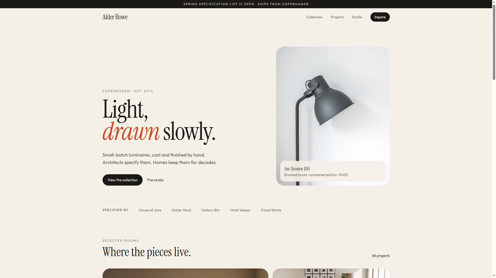
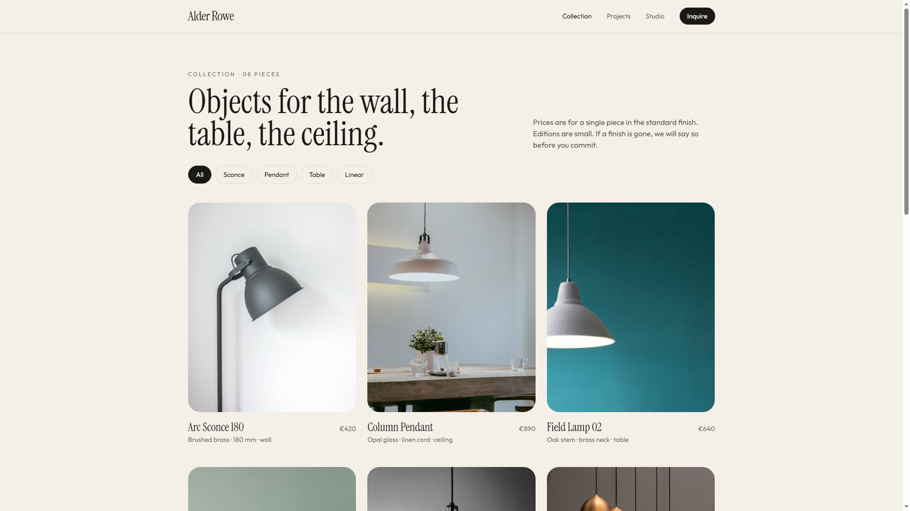

# Alder Rowe

A five-page site for a lighting workshop. Visitors can browse the collection, filter it by type, and open an inquiry with the piece already named.

The workshop, the prices, and the projects are made up. The interface is the work: one layout, routes that still load after a refresh, and a form that will not submit until the fields are actually filled.



## Walkthrough

**Collection.** Eight pieces. The filters are Sconce, Pendant, Table, and Linear. Each card goes to `/inquire?piece=...`, and the note starts from that name.



**Inquiry.** Name, email, and a short note are required. A broken email stays on the form. A valid note is replaced by the confirmation. Nothing is sent to a server.

**Projects and studio.** Four rooms, then the workshop: what they will take on, and the three people who make the work.

## Stack

- React 19
- React Router 7
- Vite 8
- Tailwind CSS 4

## Scripts

```bash
npm install
npm run dev
npm run build
npm run lint
```

`npm run dev` serves the site at http://localhost:5173.

## How the code is split

```
src/App.jsx                       route table
src/components/Layout.jsx         header, footer, mobile menu
src/components/ProductCard.jsx    cards on the home page and the collection
src/pages/                        one component per route
src/data.js                       pieces, projects, people
vercel.json                       refresh fallback for Vercel
```

Copy sits in `data.js`. The pages are mostly layout. The mobile menu is tied to the current path, so it closes when you move to another page.

## Deploy

On Vercel, keep the Vite preset: build command `npm run build`, output directory `dist`.

`vercel.json` rewrites every path to `index.html`. Without it, the home page loads and `/collection` 404s as soon as the page is refreshed.
